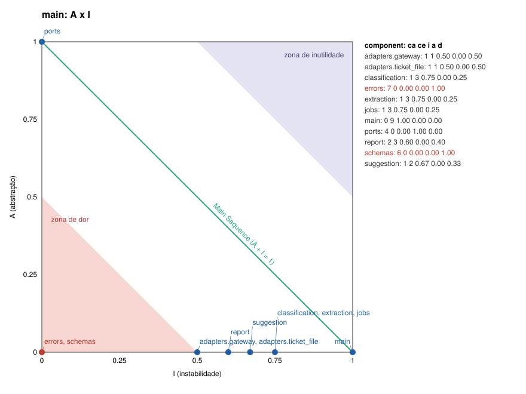

# Helpdesk com IA: da integração frágil à arquitetura resiliente

Entrega do desafio do módulo Arquitetura na Era da IA. O enunciado continua no [repositório base](https://github.com/devfullcycle/desafio-arquitetura-era-ia-1).

Marcos no git: tag `v1-coupled` (aplicação recebida + suíte de caracterização), tag `v2-decoupled` (aplicação refatorada atrás do gateway, mesmo comportamento) e branch `main` (modo de execução decidido por feature).

## Visão geral

A aplicação do helpdesk deixou de falar com OpenAI e Anthropic. Ela pede **capacidades lógicas** (`helpdesk-classify`, `helpdesk-suggest`, `helpdesk-topics`, `helpdesk-extract`) a um **AI Gateway self-hosted** (LiteLLM Proxy, serviço `gateway`, com Postgres em `gateway-db`), usando uma chave virtual própria. Provider, modelo físico, credenciais, preço, orçamento, limites, timeouts, retries e fallback vivem em `gateway/`. Dentro de `app/`, as features dependem só de contratos (`ports.py`); o único componente que chama o gateway é `app/helpdesk/adapters/gateway.py`, montado em `main.py`. Cada feature responde no modo que o contrato pede: F1 e F4 síncronas com prazo, F2 em streaming (SSE) e F3 em Asynchronous Request-Reply (`202` + URL de status).

**Quando um provider cai**, o gateway tenta o destino primário no máximo 2 vezes (com backoff) e passa para o modelo `large` equivalente do outro provider; o helpdesk inteiro continua respondendo. Se os dois `large` caírem, classificação, sugestão e relatório degradam para o `gpt-fake-mini` (saída igual ou um rascunho mais curto), e a extração de pedido falha explicitamente com `503`, porque alimenta uma automação sem revisão humana e o mini troca o número do pedido pelo da nota fiscal. Nenhuma requisição fica pendurada até a borda devolver `504`: a aplicação tem prazo explícito em toda chamada.

## Diagnóstico da v1

Ambiente: `git checkout v1-coupled && cp .env.example .env && docker compose up -d --build --wait`. O script [`scripts/diagnose-v1.sh`](scripts/diagnose-v1.sh) (da `main`) reproduz as dores 1 a 3 e imprime status, tempos e o `/admin/calls`. Os números abaixo são de uma execução dele (horários do `/admin/calls` em UTC).

### Dor 1: o relatório do mês nunca chega

```
curl -s -o /dev/null -w "%{http_code} %{time_total}\n" -X POST localhost:8000/reports/topics \
  -H "Content-Type: application/json" -d '{"start": "2026-08-01", "end": "2026-08-31"}'
curl -s "localhost:8090/admin/calls?last=50"
```

- **Observado:** `status=504 tempo=30.02s`. Até o `504`, o `/admin/calls` tinha 3 chamadas `anthropic claude-fake-large topics status=200` de ~9.830 ms, **uma depois da outra**, e a 4ª em andamento. 60 s depois do `504`, as chamadas continuavam chegando a cada ~9,8 s (`01:05:55`, `01:06:04`, `01:06:14` ... `01:06:53`), e ainda apareciam durante a dor 3a, minutos depois. São 34 lotes (5.000 tickets ÷ 150), ~336 s no total e ~US$ 0,86 de tokens que ninguém vai receber.

```
  01:05:25.642 anthropic claude-fake-large topics   stream=False status=200 dur_ms=9828
  01:05:35.473 anthropic claude-fake-large topics   stream=False status=200 dur_ms=9828
  01:05:45.304 anthropic claude-fake-large topics   stream=False status=200 dur_ms=9827
  01:05:55.134 anthropic claude-fake-large topics   stream=False status=None dur_ms=None   <- 504 da borda aqui
  ...
  01:06:53.240 anthropic claude-fake-large topics   stream=False status=None dur_ms=None   <- 60 s depois, ainda gastando
```
- **Causa:**
  - `app/helpdesk/report.py`: o laço `for first in range(0, len(selected), config.TICKETS_PER_CALL)` chama `llm.call_anthropic(...)` lote a lote, dentro da requisição HTTP síncrona; nada é enviado à borda até o fim.
  - `edge/nginx.conf`: `proxy_read_timeout 30s` encerra a requisição; o timeout mais curto da cadeia vence.
  - Desistir não é cancelar: a rota é `def` (roda num thread do FastAPI) e continua o laço depois que a borda desiste; o cliente do SDK (`app/helpdesk/llm.py`) não tem prazo (padrão de 600 s).

### Dor 2: o atendente olha 15 s para uma tela parada

```
curl -s -o /dev/null -w "%{http_code} primeiro_byte=%{time_starttransfer} total=%{time_total}\n" \
  -X POST localhost:8000/tickets/reply-suggestion -H "Content-Type: application/json" \
  -d '{"ticket_id": "TK-00042", "text": "Meu pedido #481516 não chegou e já passou do prazo, urgente"}'
```

- **Observado:** `status=200 primeiro_byte=15.96s total=15.96s`: o primeiro byte só chega junto com o último (0,8 s até o 1º token + 603 tokens ÷ 40 tokens/s). O `/admin/calls` mostra `claude-fake-large suggest stream=False`: o provider sabe fazer streaming, mas a aplicação pede tudo de uma vez.
- **Causa:** `app/helpdesk/llm.py` (`call_anthropic` usa `messages.create` sem `stream`) e `app/helpdesk/suggestion.py` + rota `suggest_reply` em `main.py`, que devolvem um JSON só quando o texto termina.

### Dor 3: com um provider fora ou travado, metade do helpdesk para

```
curl -s -X POST localhost:8090/admin/failures -H "Content-Type: application/json" \
  -d '{"provider": "anthropic", "mode": "error_500"}'
# F1 e F4 (openai) respondem 200; F2 e F3 (anthropic) respondem 500
curl -s -X POST localhost:8090/admin/failures -H "Content-Type: application/json" \
  -d '{"provider": "anthropic", "mode": "timeout"}'
# F2 termina em 504 da borda depois de 30 s
```

- **Observado (`error_500`):** `/tickets/classification status=200 tempo=1.08s`, `/tickets/reply-suggestion status=500 tempo=1.34s`, `/tickets/extraction status=200 tempo=1.08s`. O `/admin/calls` mostra **3** chamadas `anthropic claude-fake-large suggest status=500` em ~1,3 s (a original + 2 retries do SDK), sem nenhuma tentativa na OpenAI. (As chamadas `topics status=500` intercaladas são o relatório da dor 1, que ainda estava rodando.)
- **Observado (`timeout`):** `/tickets/reply-suggestion status=504 tempo=30.03s`; a chamada no `/admin/calls` fica com `status=504 dur_ms=None` (o provider ainda segura a conexão), e a aplicação continua esperando: o SDK aceita até 600 s e repetiria mais 2 vezes.
- **Causa:** `app/helpdesk/config.py` amarra cada feature a um provider (`SUGGESTION_MODEL`/`REPORT_MODEL = "claude-fake-large"`, `CLASSIFICATION_MODEL`/`EXTRACTION_MODEL = "gpt-fake-large"`); `app/helpdesk/llm.py` cria os clientes sem `timeout` nem `max_retries`, valendo os padrões dos SDKs (600 s, 2 retries), e não existe fallback.

### Dor 4: trocar o modelo exige mudar código e reconstruir

```
# trocar a classificação para o modelo mais barato
sed -i 's/CLASSIFICATION_MODEL = "gpt-fake-large"/CLASSIFICATION_MODEL = "gpt-fake-mini"/' app/helpdesk/config.py
docker compose restart app          # não muda nada: o código está dentro da imagem
docker compose up -d --build app    # só assim a próxima chamada usa o gpt-fake-mini
git checkout app/helpdesk/config.py && docker compose up -d --build app   # desfaz
```

- **Observado:** depois do `restart`, o `/admin/calls` ainda mostra `gpt-fake-large`; só depois do `--build` (deploy) aparece `gpt-fake-mini`.
- **Causa:** `app/helpdesk/config.py` guarda o nome físico do modelo e `app/Dockerfile` copia o código para a imagem (`COPY helpdesk ./helpdesk`): modelo é código, então trocar modelo é deploy.

## Como rodar

```
cp .env.example .env
docker compose up -d --build --wait
curl -s localhost:8000/health
```

Serviços: `provider-fake` (8090), `edge` (8000, entrada oficial), `app`, `gateway` (LiteLLM, 4000) e `gateway-db` (Postgres). Na primeira subida o gateway roda as migrações do banco e cria as chaves virtuais; o `--wait` só retorna depois disso.

Testes (precisam só de Python 3 no host, sem dependências; rodam pela borda e usam o `/admin` do provider):

```
# suíte de caracterização (nas tags, o contrato antigo; na main, o contrato novo de F2/F3)
python3 -m unittest discover -s tests/characterization -v

# testes de aceite da main: tempos pela borda e cenários de falha do provider (~4 min)
python3 -m unittest discover -s tests/acceptance -v
```

Métrica de acoplamento (só biblioteca padrão):

```
python3 metrics/coupling.py app/helpdesk main
# medir uma tag com o script da main:
git worktree add ../v1 v1-coupled && python3 metrics/coupling.py ../v1/app/helpdesk v1-coupled
git worktree add ../v2 v2-decoupled && python3 metrics/coupling.py ../v2/app/helpdesk v2-decoupled
```

Cada execução grava `metrics/results/<nome>.csv` e `metrics/results/<nome>.svg`.

## Métrica

| | v1-coupled | v2-decoupled | main |
|---|---|---|---|
| gráfico | [v1-coupled.svg](metrics/results/v1-coupled.svg) | [v2-decoupled.svg](metrics/results/v2-decoupled.svg) | [main.svg](metrics/results/main.svg) |
| CSV | [v1-coupled.csv](metrics/results/v1-coupled.csv) | [v2-decoupled.csv](metrics/results/v2-decoupled.csv) | [main.csv](metrics/results/main.csv) |
| zona de dor | `config`, `llm`, `schemas` | `schemas`, `errors` (declarados) | `schemas`, `errors` (declarados) |



**O que saiu de onde, e por quê:**

- **`config` (v1: Ca 6, D 1,00) e `llm` (v1: Ca 4, I 0,20, D 0,80) desapareceram.** Eram o acoplamento ao que é volátil (chaves, URLs, nomes de modelo, dois SDKs) e eram importados por todas as features. As chaves e os modelos foram para `gateway/config.yaml`; o que sobrou de configuração (URL e chave do gateway, nomes lógicos, prazos) é lido em `main.py`, o ponto de composição. O piloto mostrou que só reduzir o Ca de `config` não o tiraria da zona (folha concreta tem I = 0 com qualquer Ca), daí a revisão 2 do [plano](docs/refactoring-plan.md).
- **`ports` nasceu em A 1,00, I 0,00, D 0,00**: contratos estáveis e abstratos, sobre a Main Sequence. No piloto ele nasceu com D 0,67 porque misturava as exceções de domínio com os Protocols; a revisão 1 separou `errors`.
- **`adapters.gateway` (I 0,50, D 0,50)** é o único componente que chama o gateway; só `main` o importa e ele só depende de `errors`. Fica na fronteira da zona, fora dela.
- **Features** (`classification`, `extraction` 0,25; `suggestion` 0,33; `report` 0,40; `jobs` 0,25): continuam concretas, mas passaram a depender só de `ports`, `schemas` e `errors`. O D delas não melhorou em relação à v1 (0,25), e não precisava: o ganho é *o que* elas importam, não a distância.
- **`main`** (I 1,00): ponto de composição, instável por definição.

**Exceções declaradas** ([ADR 0009](docs/adr/0009-leitura-da-metrica.md)): `schemas` (tipos de valor pydantic do contrato da API) e `errors` (exceções de domínio sem comportamento), estáveis por natureza. O componente que chama o gateway e as features não são exceção e estão fora da zona de dor.

## Tabela de capacidades

O máximo de tentativas vale por destino (`router_settings.num_retries: 1` no gateway, backoff exponencial de 0,5 s + jitter; cooldown desligado). Configuração em [`gateway/config.yaml`](gateway/config.yaml).

| capacidade lógica | feature | modelo primário | fallback técnico | política com modelo fraco | máx. tentativas por destino |
|---|---|---|---|---|---|
| `helpdesk-classify` | F1 Classificar | `gpt-fake-large` (openai) | `claude-fake-large` (anthropic) | aceita `gpt-fake-mini` | primário 2, fallback 2, mini 2 |
| `helpdesk-suggest` | F2 Sugerir | `claude-fake-large` (anthropic) | `gpt-fake-large` (openai) | aceita `gpt-fake-mini` | primário 2, fallback 2, mini 2 |
| `helpdesk-topics` | F3 Relatório | `claude-fake-large` (anthropic) | `gpt-fake-large` (openai) | aceita `gpt-fake-mini` | primário 2, fallback 2, mini 2 (por lote) |
| `helpdesk-extract` | F4 Extrair | `gpt-fake-large` (openai) | `claude-fake-large` (anthropic) | **não usa mini**: falha explícita | primário 2, fallback 2 |

Timeouts por tentativa no gateway: 3 s (F1, F4), 5 s sem trecho (F2), 15 s por lote (F3). Prazos totais na aplicação: 12 s (F1, F4), 14 s até o primeiro trecho (F2), 50 s por lote (F3). O SDK da aplicação não faz retry (`max_retries=0`).

## Tabela de fallback

Com os dois modelos `large` indisponíveis (ex.: `gpt-fake-large` e `claude-fake-large` em `error_500`). Decisão e evidência no [ADR 0007](docs/adr/0007-resiliencia-e-fallback.md).

| feature | o que acontece | status | resposta |
|---|---|---|---|
| F1 Classificar | responde com o `gpt-fake-mini` (classificação idêntica à do large) | `200` | `{"ticket_id", "category", "priority"}` |
| F2 Sugerir | responde com o `gpt-fake-mini` em streaming (texto mais curto, mesmos passos) | `200` | `text/event-stream` com `data: {"chunk"}` e `event: end` |
| F3 Relatório | a tarefa termina com o `gpt-fake-mini` (temas e contagens idênticos) | `202`, depois `303` | relatório completo em `/reports/topics/{id}` |
| F4 Extrair | falha explicitamente; o mini não é chamado | `503` | `{"detail": "Nenhum modelo atendeu 'helpdesk-extract': ..."}` |

Com só um provider fora, todas as features respondem normalmente pelo `large` do outro provider.

## Fluxos

### F1 Classificar ticket: síncrono

```
curl -s -X POST localhost:8000/tickets/classification -H "Content-Type: application/json" \
  -d '{"ticket_id": "TK-00042", "text": "Meu pedido #481516 não chegou e já passou do prazo, urgente"}'
# 200 {"ticket_id":"TK-00042","category":"delivery","priority":"high"}
```

### F2 Sugerir resposta: streaming (SSE)

```
curl -sN -X POST localhost:8000/tickets/reply-suggestion -H "Content-Type: application/json" \
  -d '{"ticket_id": "TK-00042", "text": "Meu pedido #481516 não chegou e já passou do prazo, urgente"}'
# 200 Content-Type: text/event-stream
# data: {"chunk": "Olá!"}
# data: {"chunk": " Sin"}
# ...
# event: end
# data: {"ticket_id": "TK-00042"}
```

Erro depois do primeiro trecho (o `200` já foi enviado) chega como `event: error` com `data: {"ticket_id": "TK-00042", "message": "A geração foi interrompida"}` e o stream termina. Erro antes do primeiro trecho responde `503` (ou `429` por governança) com `{"detail": ...}`. A resposta leva `X-Accel-Buffering: no` para a borda não acumular o stream.

### F3 Relatório de temas: Asynchronous Request-Reply

```
curl -si -X POST localhost:8000/reports/topics -H "Content-Type: application/json" \
  -d '{"start": "2026-08-01", "end": "2026-08-31"}'
# 202 Accepted
# Location: /reports/topics/status/7f3a9c1e2b4d
# Retry-After: 5
# {"job_id":"7f3a9c1e2b4d","state":"pending"}

curl -si localhost:8000/reports/topics/status/7f3a9c1e2b4d
# 200 {"state":"running","progress":"1800/5000"}      (ou {"state":"failed","reason":"..."})
# 303 See Other, Location: /reports/topics/7f3a9c1e2b4d   (quando termina)

curl -sL localhost:8000/reports/topics/status/7f3a9c1e2b4d
# 200 {"start":"2026-08-01","end":"2026-08-31","total_tickets":5000,"topics":[...]}
```

Campo adicional ao contrato sugerido: o corpo do `202` traz `job_id` e `state`. `GET /reports/topics/{id}` responde `404` enquanto o relatório não está pronto. O mês inteiro fica pronto em ~1,5 min (34 lotes, 4 em paralelo). Período inválido (início depois do fim) é recusado na hora com `422`.

### F4 Extrair dados do pedido: síncrono

```
curl -s -X POST localhost:8000/tickets/extraction -H "Content-Type: application/json" \
  -d '{"ticket_id": "TK-00002", "text": "Tenho aqui a nota fiscal 530720. O produto veio quebrado na caixa, pedido #605065."}'
# 200 {"ticket_id":"TK-00002","order_number":"#605065","product":null}
```

## Troca de modelo

Arquivo: [`gateway/config.yaml`](gateway/config.yaml). Altere o campo `model` (e o preço, para o orçamento continuar certo) do bloco da capacidade e reinicie só o gateway. Exemplo: classificação no modelo mais barato.

```
sed -i '/model_name: helpdesk-classify$/,/output_cost_per_token/{s#openai/gpt-fake-large#openai/gpt-fake-mini#;s#input_cost_per_token: 0.0000025#input_cost_per_token: 0.00000015#;s#output_cost_per_token: 0.00001#output_cost_per_token: 0.0000006#}' gateway/config.yaml
docker compose restart gateway && docker compose up -d --wait gateway

curl -s -X POST localhost:8090/admin/reset
curl -s -X POST localhost:8000/tickets/classification -H "Content-Type: application/json" \
  -d '{"ticket_id": "TK-1", "text": "Meu pedido não chegou"}'
curl -s "localhost:8090/admin/calls?last=1"        # "model": "gpt-fake-mini"
docker compose ps app                              # o app não foi reiniciado (mesmo "Up ...")

git checkout gateway/config.yaml && docker compose restart gateway   # desfaz
```

No macOS, use `sed -i ''` (ou edite as três linhas do bloco `helpdesk-classify` à mão). O `app` não é reconstruído nem reiniciado: ele só conhece o nome `helpdesk-classify`.

## Roteiro de governança

Chaves criadas automaticamente na subida ([`gateway/keys.json`](gateway/keys.json), [ADR 0006](docs/adr/0006-governanca-de-chaves.md)): `sk-demo-budget-0001` com orçamento de US$ 0,0001 e `sk-demo-rpm-0001` com 2 requisições por minuto. Uma classificação custa ~US$ 0,00014.

```
G='localhost:4000/v1/chat/completions'
BODY='{"model": "helpdesk-classify", "messages": [{"role": "user", "content": "TASK: classify\nMeu pedido não chegou"}]}'
count() { curl -s "localhost:8090/admin/calls?last=5000" | python3 -c 'import json,sys; print("chamadas no provider:", len(json.load(sys.stdin)))'; }

# 1) Recusa por orçamento
curl -s -X POST localhost:8090/admin/reset
curl -s -o /dev/null -w "1ª: %{http_code}\n" $G -H "Authorization: Bearer sk-demo-budget-0001" -H "Content-Type: application/json" -d "$BODY"
sleep 3; count                                    # chamadas no provider: 1
curl -s -w "\n2ª: %{http_code}\n" $G -H "Authorization: Bearer sk-demo-budget-0001" -H "Content-Type: application/json" -d "$BODY"
count                                             # continua 1: a recusa (429, type budget_exceeded) não chegou ao provider

# 2) Recusa por limite de requisições (rodar as 3 no mesmo minuto)
curl -s -X POST localhost:8090/admin/reset
for i in 1 2 3; do
  curl -s -o /dev/null -w "$i: %{http_code}\n" $G -H "Authorization: Bearer sk-demo-rpm-0001" -H "Content-Type: application/json" -d "$BODY"
done                                              # 1: 200, 2: 200, 3: 429
count                                             # chamadas no provider: 2
```

Depois de a chave de orçamento estourar, ela continua recusando até o ambiente ser recriado (`docker compose down && docker compose up -d --wait`), porque o gasto fica no `gateway-db`.

## Mapa de decisões

| ADR | nível | resumo |
|---|---|---|
| [0001](docs/adr/0001-politica-corporativa-de-ia.md) | corporativa | Só OpenAI e Anthropic, sempre pelo gateway da empresa; teto de US$ 100/mês para o helpdesk |
| [0002](docs/adr/0002-ai-gateway-litellm.md) | solução | LiteLLM Proxy self-hosted como proxy de saída da aplicação; chaves criadas na subida |
| [0003](docs/adr/0003-capacidades-logicas.md) | solução | Uma capacidade lógica por feature; modelo físico, provider e preço mapeados no gateway |
| [0004](docs/adr/0004-modo-de-execucao-por-feature.md) | solução | F1 e F4 síncronas com prazo, F2 em SSE, F3 em Asynchronous Request-Reply em memória |
| [0005](docs/adr/0005-banco-do-gateway.md) | solução | Serviço `gateway-db` (Postgres) para chaves virtuais, gasto e orçamento |
| [0006](docs/adr/0006-governanca-de-chaves.md) | solução | Uma chave virtual por consumidor, com orçamento e RPM; preços declarados no gateway |
| [0007](docs/adr/0007-resiliencia-e-fallback.md) | solução | Timeout, 2 tentativas por destino e fallback técnico no gateway; mini aceito em F1/F2/F3, recusado em F4 |
| [0008](docs/adr/0008-portas-e-adaptadores.md) | software | Features dependem de Protocols; `adapters/gateway.py` é o único cliente do gateway |
| [0009](docs/adr/0009-leitura-da-metrica.md) | software | Leitura dos gráficos; `schemas` e `errors` declarados estáveis por natureza |

Plano, piloto, revisões e handoff da refatoração: [`docs/refactoring-plan.md`](docs/refactoring-plan.md).
